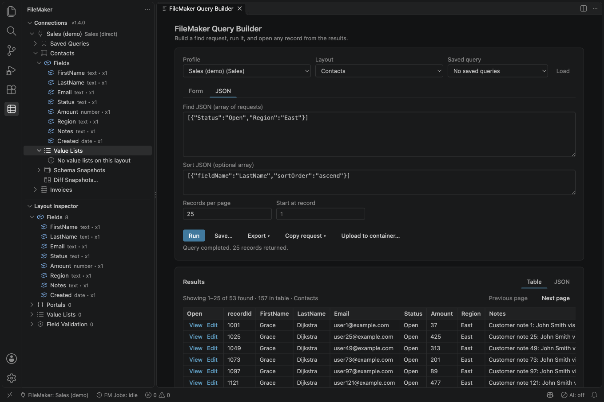
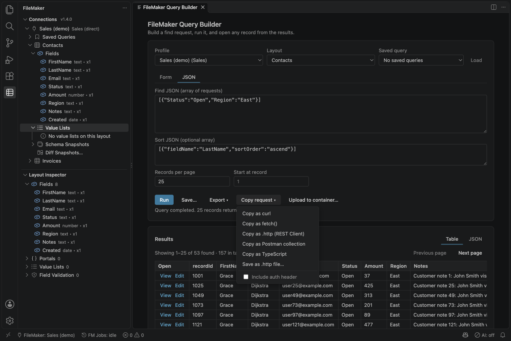
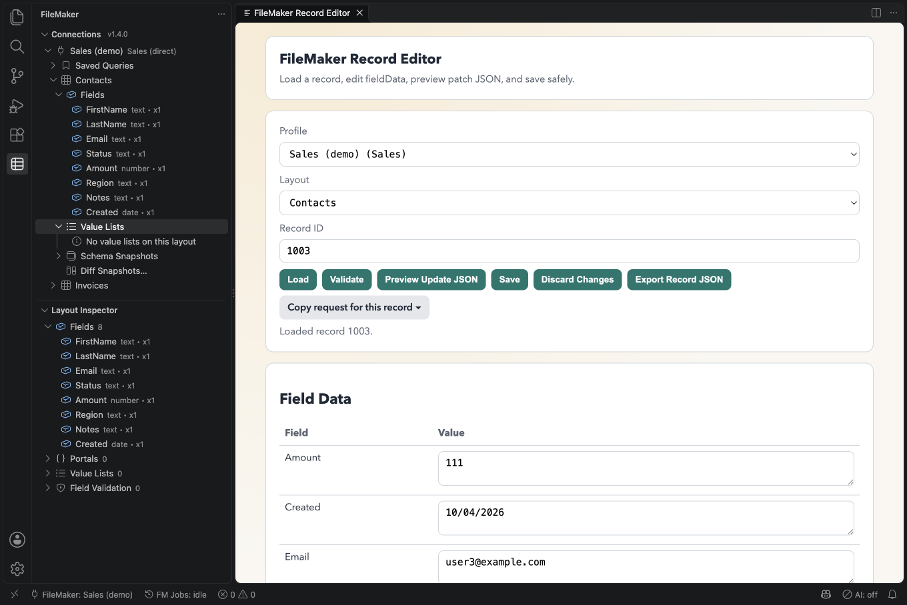
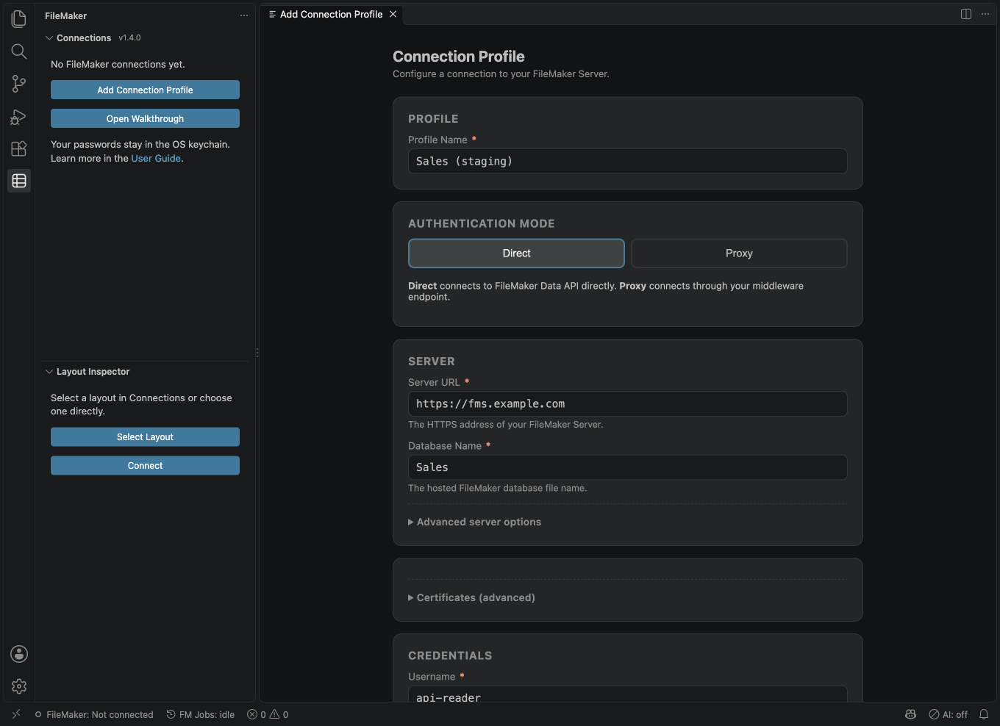
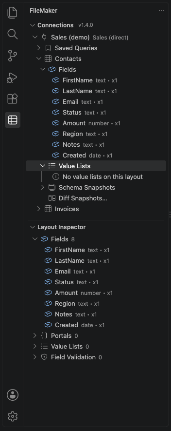
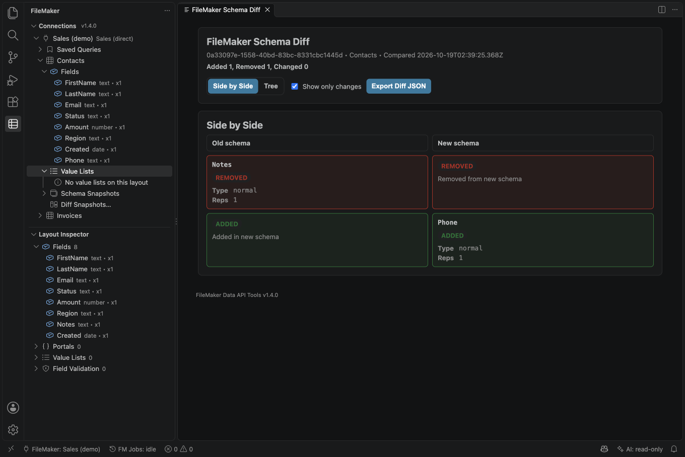
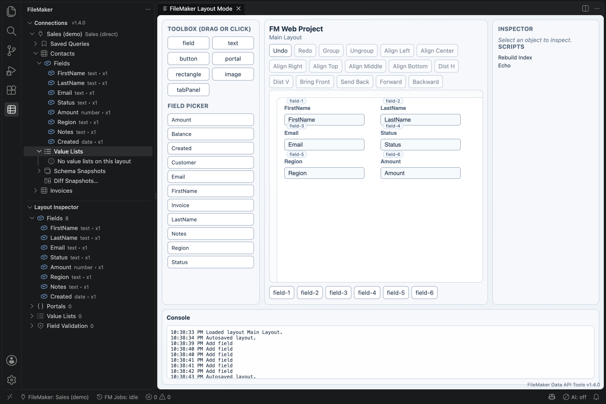
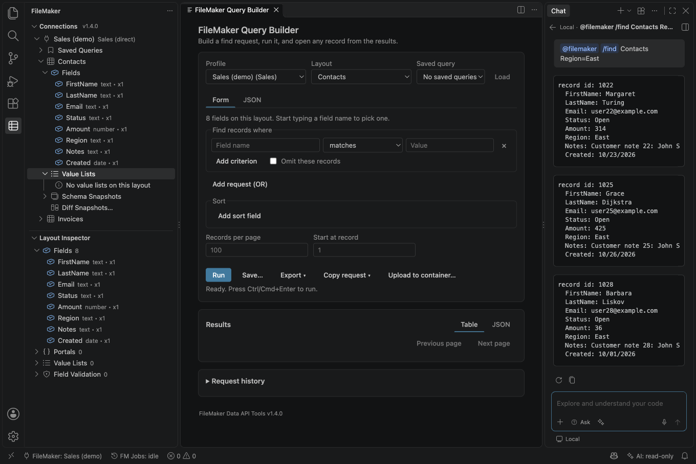

# FileMaker Data API Tools

For Claris FileMaker Server (Data API). FileMaker Cloud sign-in with a Claris ID is not supported yet; Cloud is untested.

Work with a FileMaker database from VS Code: connect to a server, inspect layouts, run finds, edit records, compare schema snapshots, export large result sets, generate TypeScript types, and review diagnostics without leaving the editor.

**Built by [ABD Enterprises](https://abdenterprises.com).** Free, open source (MIT), no telemetry, no cloud account.

Version **1.7.0** adds checks for newer changes before batch updates, read-only calculated fields in the editor, **List records instead** for an empty search, and **Test My Server** and **Diagnose Connection** to explain connection problems. Exports preserve text and record versions, and **Cancel Job** and **Show Jobs** are always available. See the [upgrade notes](https://github.com/SureForgeTech/filemaker-data-api-for-vs-code/blob/main/extension/UPGRADE.md) before importing a file.

One real FileMaker server was exercised on **2026-10-21**, but its version was not recorded. No server version has a completed recorded smoke test; see [Compatibility](https://github.com/SureForgeTech/filemaker-data-api-for-vs-code/blob/main/extension/docs/COMPATIBILITY.md). FileMaker Cloud sign-in with a Claris ID is **not supported**.

## What it does

- **Connect** directly to the FileMaker Data API or through your own proxy. Passwords stay in your operating system keychain.
- **Find** with a visual query builder or raw JSON, and page, sort and export the results.
- **Edit** records (create, update, delete, container upload), in a trusted workspace. If someone else changed a record, your save is refused instead of overwriting theirs.
- **Run scripts** with parameters and see the result.
- **Copy any request as code**: curl, fetch(), a `.http` file, a Postman collection or TypeScript, from the Query Builder, Script Runner, record panels or the Command Palette. Passwords and tokens are never copied.
- **Track schema**: capture snapshots, diff them, compare environments, and generate TypeScript types, a typed client and editor snippets.
- **Batch**: export to JSONL or CSV, or update many records from a CSV or JSON file, with a dry run first.
- **Control**: workspace trust (Restricted Mode keeps editing, scripts and batch jobs off), an enterprise mode with roles, an offline metadata mode, and confirmation before risky actions.
- **Trust a private server on purpose**: for FileMaker Server's default certificate or a company certificate, review the certificate in the connection wizard and trust exactly that one by its fingerprint. A different certificate later is refused before credentials are sent, including with VS Code's default proxy setting. This needs a direct route; a required proxy is refused with advice. See the User Guide's Certificates section.
- **AI, off by default**: give AI coding tools your real layout names, let an agent in VS Code or an MCP client (Claude Code, Cursor) read records and, with your approval, change one record at a time, or ask `@filemaker` in the Chat view (read only).
- **Windows, Linux and macOS**: build, lint, type check and the unit tests run on Windows and Linux in CI.

## Product tour

The screenshots show a mock FileMaker Data API with made-up data (names and `example.com` addresses), not a real server. They were taken in an older version: version labels and some field styling differ in 1.7.0; panels now follow the editor theme.

The query builder gives you a readable form for FileMaker find requests (or the JSON request itself), with sorting, paging, saved queries and export.

**Copy request** turns what you just built into curl, `fetch()`, a `.http` file for REST Client, a Postman collection or TypeScript. The password and session token are never copied.

The record editor shows the fields your account can read, previews the update before it is sent, and refuses to save over a record someone else changed. When field details are available, calculation, summary and container fields are read-only; use Upload to Container for containers.

The connection wizard takes a direct or proxy connection, tests it step by step, and keeps the password in your operating system keychain.

The sidebar lists connections, layouts, fields, saved queries and schema snapshots, and the Layout Inspector shows one layout in detail.

Capture schema snapshots and compare them to see which fields were added, removed or changed.

Layout Mode places fields from a synced layout on a canvas for an FM Web project. Generating and previewing an FM Web app need the source checkout; those commands are not in the Marketplace package. Standard field sizes and spacing, an action that arranges the selection into a standard form, one that standardizes it (each undone in one step) and blank, form, two-column and first-portal starter templates keep layouts tidy. The find form, Record Editor and Record Viewer show fields the same way.

`@filemaker` in VS Code's Chat view reads the database through the same safety rules as the AI tools, read only. This screenshot was made with a stand-in language model; the records come from the extension.

## Requirements

- FileMaker Server with the **Data API** enabled, reachable over HTTPS. FileMaker Cloud is untested: the extension has no Claris ID login, and whether a tenant accepts an account name and password is not confirmed.
- A FileMaker account whose privilege set has the **`fmrest`** extended privilege.
- A server certificate your computer trusts. For FileMaker Server's default certificate, a private authority or a self-signed certificate, the connection wizard lets you review the certificate and trust exactly that one (or set a CA file). Trusting a fingerprint works on direct connections with VS Code's default proxy setting too. A required proxy is refused for a pinned connection; custom CA profiles keep their existing routing (see the User Guide, Certificates).
- VS Code 1.96 or newer on a macOS, Windows or Linux desktop, with a folder open (virtual workspaces such as github.dev are not supported). The AI server for MCP clients does not run in remote windows (SSH, WSL, Dev Containers, Codespaces).

See [Compatibility](https://github.com/SureForgeTech/filemaker-data-api-for-vs-code/blob/main/extension/docs/COMPATIBILITY.md) for server versions, operating systems and what has and has not been tested. The automated tests run against a mock of the Data API built from Claris's documentation.

## Install

1. Open the Extensions view in VS Code.
2. Search for `FileMaker Data API Tools` (publisher SureForgeTech).
3. Select **Install**.

To install a specific version, download the `.vsix` from the [GitHub releases](https://github.com/SureForgeTech/filemaker-data-api-for-vs-code/releases) and run **Extensions: Install from VSIX...**.

## Quick start

1. Run **FileMaker: Add Connection Profile**. Choose **Direct** (server URL, database, account) or **Proxy** (server URL, database, proxy endpoint).
2. Select **Test Connection**, then **Save Profile**, then **Connect Now**.
3. Run **FileMaker: Open Query Builder**, pick a layout, add a condition and select **Run**.

For guided steps, run **FileMaker: Open Getting Started Walkthrough**. The full manual is the [User Guide](https://github.com/SureForgeTech/filemaker-data-api-for-vs-code/blob/main/extension/docs/USER_GUIDE.md) (also in VS Code: **FileMaker: Open User Guide**).

## AI tools

Off by default. Turn on `filemaker.ai.enabled` in your **user** settings (a workspace setting cannot), pick a connection with **FileMaker: Set AI Access for Connection**, and AI tools in VS Code (for example Copilot agent mode) can list layouts and scripts, describe a layout, find and read records, and explain error codes. With `filemaker.ai.allowWrites` they can also create, edit and delete one record at a time, and with `filemaker.ai.allowScripts` run scripts you put on `filemaker.ai.scriptAllowlist`. **FileMaker: Write AI Context** writes a short file of layout, field and script names that AI coding tools can load.

**Chat with `@filemaker`.** In VS Code's Chat view, `@filemaker /layouts`, `/describe`, `/find` and `/explain` read the database through the same tools and rules, read only, with everything from the database shown as plain text. See the User Guide, "Chat with @filemaker".

What protects you, and what does not:

- **Read-only first.** Write and script tools are not offered until you switch them on. A connection has to be set to AI access "read" or "write" first. The status bar shows the effective state for the chosen connection.
- **You approve.** The first read of each layout asks once per session (at most 20 layouts a session). Every write asks in a dialog that VS Code cannot set to "always allow". A write is limited to 10 fields and 200 characters per value so the dialog can show every field name and every new value in full; anything larger is refused. A long old value is shown cut, with the number of characters left out. Delete asks you to type the record id. A record changed in the meantime is not overwritten, and if you switch AI off while a dialog is open, nothing is sent. A call whose values already match the record writes nothing and asks nothing; it still counts one record against the read quota.
- **Limits.** 50 records per call and 500 per session (reserved before the request is sent, so parallel calls cannot exceed it), 30 calls per minute, 10 write attempts per session and 3 per minute (a declined attempt counts). Switching the kill switch off and on does not reset these; **FileMaker: Start New AI Session** does, after asking you. The status bar item shows the state; one click switches everything off, and switching back on asks you. **FileMaker: Show AI Activity** lists what was done (no field values).
- **Use a restricted FileMaker account.** FileMaker privilege sets are the only control that does not depend on the AI model or on you. Connect with a dedicated account with a read-only privilege set.
- **Data goes to the model provider.** Anything a tool returns is sent to the AI model you chose, and can leave through any shell, web or git tool the same agent has. Field values and field names are text from your database; a hostile value or name can try to steer the agent. Container fields, container streaming URLs and the server address are left out of results; other text in a value is passed on.
- **Hidden fields are best effort.** `filemaker.ai.hiddenFields` hides fields by name from the AI tools and from the file Write AI Context writes (repetitions such as `Salary(2)` included). It does not stop disclosure through a calculation, a summary field or a script.
- **Keep policy in user settings.** A workspace file can be edited by an agent that has file-editing tools. Put `filemaker.ai.hiddenFields` and enterprise settings such as `filemaker.features.ai.enabled` in your **user** settings (or in an enterprise-managed location), not only in `.vscode/settings.json` or `.vscode/filemaker.config.json`. The `filemaker.ai.*` settings that widen access already ignore workspace values.
- **Tool names.** The tools are called `fm_list_layouts`, `fm_find_records` and so on. VS Code tool names share one namespace across extensions; the prefix `fm_` makes a clash unlikely.

### Claude Code, Cursor and other MCP clients

The same tools, with the same limits, approvals and dialogs, are available to MCP clients that run outside VS Code. This is off by default and works in local windows only (not Dev Containers, Codespaces, SSH or WSL windows).

1. Turn on `filemaker.ai.enabled` and set up a connection as above, then run **FileMaker: Start/Stop AI Server for External Tools** in the window you want to use. The command always asks in a dialog first (it says the server will start automatically each time you open this workspace); if `filemaker.ai.externalServer.enabled` is off, the same dialog turns it on in your user settings. Nothing can start the server, or make it start automatically, without that dialog. The status bar then shows "MCP".
2. Run **FileMaker: Copy MCP Config for Claude Code / Cursor** and paste the result into Claude Code's `.mcp.json` (or run `claude mcp add-json filemaker '<the filemaker entry>'`) or into Cursor's `mcp.json`. The config points at a copy of the shim in the extension's storage that is refreshed whenever the server starts, so it keeps working after extension updates. If the copy could not be made, the message says so and you copy the config again after an update.
3. The client starts a small program (`node .../aiMcpShim.js`) that connects to this window. **Node.js 18 or newer must be on the PATH of the client**; without it the config cannot run.

**The setting is a permission, not a switch.** `filemaker.ai.externalServer.enabled` (user settings only) only allows the server. It does not start it anywhere. The server runs in a window only after you run **Start/Stop AI Server for External Tools** in that window. VS Code then remembers that for that workspace: the server starts again each time you open it, as long as the setting is on, until you run the same command there to stop it. Stopping clears that memory and keeps it stopped, also after a restart. Turning the setting off stops the server in every window where it runs and ends the automatic start for every workspace, including workspaces that are closed at that moment: turning the setting back on does not bring them back, and you start the server there again by running the command. (If you change the setting in a file while no VS Code window is open, the end of the automatic start is noticed the next time a window opens with the setting off.) A window you never started it in never runs it.

Notes: with several VS Code windows running the server, the config names the folder (`--workspace`), and the shim refuses to guess if it matches none or several. Only programs running as you can connect (each VS Code-based product, such as VS Code, Insiders or Cursor, has its own socket folder, so one never touches another's), and each needs the secret token that is kept in a file only you can read; a file from a closed window is never used, and a window whose process cannot be verified is reported and left alone. You get a notification when a program connects, and the status bar shows the number of connections. The name an MCP client gives itself is shown only in **Show AI Activity**, never in a dialog. **Everything the tools return is sent to the AI model provider behind your MCP client**, which is often a different provider from the one VS Code uses; the layout approvals and write dialogs still appear in VS Code.

See `docs/DATA_HANDLING.md` and ADR-0004 for the full list.

Details: [Using AI with FileMaker](https://github.com/SureForgeTech/filemaker-data-api-for-vs-code/blob/main/extension/docs/USER_GUIDE.md#using-ai-with-filemaker) and [Data handling](https://github.com/SureForgeTech/filemaker-data-api-for-vs-code/blob/main/docs/DATA_HANDLING.md).

## Common commands

| Command                                 | Purpose                                                                             |
| --------------------------------------- | ----------------------------------------------------------------------------------- |
| `FileMaker: Add Connection Profile`     | Create a direct or proxy connection                                                 |
| `FileMaker: Connect`                    | Start a session with a saved profile                                                |
| `FileMaker: Open Query Builder`         | Build and run find requests                                                         |
| `FileMaker: Open Record Editor`         | Edit a record                                                                       |
| `FileMaker: Create Record`              | Create a record on a layout                                                         |
| `FileMaker: Delete Record`              | Delete a record, with confirmation                                                  |
| `FileMaker: Open Script Runner`         | Run a script with a parameter                                                       |
| `FileMaker: Copy Request as Code…`      | Copy a Data API request as curl, fetch(), .http, Postman or TypeScript              |
| `FileMaker: Capture Schema Snapshot`    | Save layout metadata for later diffing                                              |
| `FileMaker: Diff Schema Snapshots`      | Compare two snapshots                                                               |
| `FileMaker: Generate Types for Layout`  | Write a TypeScript interface for a layout                                           |
| `FileMaker: Batch Export (Find)`        | Export JSONL or CSV from a find                                                     |
| `FileMaker: Batch Update from CSV/JSON` | Update many records, dry run first                                                  |
| `FileMaker: Write AI Context`           | Write layout, field and script names for AI tools                                   |
| `FileMaker: About / Show Version`       | Show the extension, build and VS Code versions; copy them for a bug report          |
| `FileMaker: Show Effective Settings`    | See which User or Workspace value is in effect and why a workspace value is ignored |
| `FileMaker: Show Diagnostics`           | Open a redacted report for bug reports                                              |

## Security and privacy

- Passwords, API keys and session tokens live in VS Code SecretStorage (your OS keychain), not in settings or logs.
- Logs, history and error details hide authorization headers, tokens and passwords.
- Editing, creating and deleting records, uploading, the Script Runner, batch jobs, writing generated files and plugins need a trusted workspace. Virtual workspaces (such as github.dev) are not supported. A repository can make the extension's policy stricter but never looser.
- The server certificate is checked. To use FileMaker Server's default certificate or a private authority's, the wizard shows the certificate and you trust that one certificate by its SHA-256 fingerprint (never from a workspace file); a different certificate later is refused on direct connections with VS Code's default proxy setting too, and a pinned connection that has to go through a proxy is refused (see the User Guide, Certificates). A pin is trust on first use: it detects a change (while the pin is applied, see above), it does not prove who you reached the first time.
- In Restricted Mode (an untrusted folder) you can browse, read metadata and run finds. The connection wizard says so and offers **Manage Workspace Trust**.
- The extension collects no telemetry. It talks only to your FileMaker server or your proxy.

Read the [security overview](https://github.com/SureForgeTech/filemaker-data-api-for-vs-code/blob/main/docs/security.md), the [data handling notes](https://github.com/SureForgeTech/filemaker-data-api-for-vs-code/blob/main/docs/DATA_HANDLING.md), and the [security policy](https://github.com/SureForgeTech/filemaker-data-api-for-vs-code/blob/main/SECURITY.md) for how to report a vulnerability.

## More

- [User Guide](https://github.com/SureForgeTech/filemaker-data-api-for-vs-code/blob/main/extension/docs/USER_GUIDE.md)
- [Changelog](https://github.com/SureForgeTech/filemaker-data-api-for-vs-code/blob/main/extension/CHANGELOG.md) and [upgrade notes](https://github.com/SureForgeTech/filemaker-data-api-for-vs-code/blob/main/extension/UPGRADE.md)
- [Compatibility](https://github.com/SureForgeTech/filemaker-data-api-for-vs-code/blob/main/extension/docs/COMPATIBILITY.md)
- [Report a bug or request a feature](https://github.com/SureForgeTech/filemaker-data-api-for-vs-code/issues)
- [Contributing](https://github.com/SureForgeTech/filemaker-data-api-for-vs-code/blob/main/extension/CONTRIBUTING.md) and [architecture](https://github.com/SureForgeTech/filemaker-data-api-for-vs-code/blob/main/extension/ARCHITECTURE.md)

## Need help with FileMaker integration?

This extension is free and MIT-licensed. The team behind it, [ABD Enterprises](https://abdenterprises.com), has been delivering FileMaker integration, migration, and modernization work since 2005.

If you need a hand with the work behind the tool:

| Engagement                 | Price            | What you get                                                |
| -------------------------- | ---------------- | ----------------------------------------------------------- |
| **Discovery Sprint**       | $3,000 / 1 week  | Documented requirements + effort estimate                   |
| **Integration Audit**      | $4,500 / 1 week  | Architecture review, gap analysis, prioritized remediation  |
| **Migration Assessment**   | $9,000 / 2 weeks | Honest evaluation: modernize within FileMaker, or move on   |
| **Platform Modernization** | $25k – $150k     | Execute the chosen path in measured phases                  |
| **Retainer**               | $5,000 / month   | Ongoing maintenance, feature work, FM Server administration |

**Contact:** [registrar@abdenterprises.com](mailto:registrar@abdenterprises.com?subject=From%20VS%20Code%20Extension) · [abdenterprises.com](https://abdenterprises.com)

## License

MIT. The licences of the third-party packages bundled into the extension are in [THIRD_PARTY_NOTICES.txt](https://github.com/SureForgeTech/filemaker-data-api-for-vs-code/blob/main/extension/THIRD_PARTY_NOTICES.txt).

## Trademarks

Claris and FileMaker are trademarks of Claris International Inc., registered in the U.S. and other countries. This extension is independent and is not affiliated with or endorsed by Claris.
